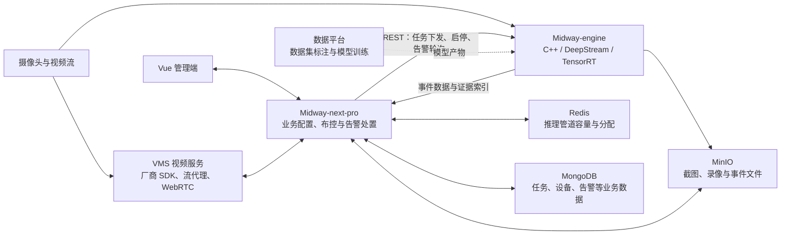

# Midway 项目梳理与简历依据

本记录用于完善项目经历与准备面试。业务端核对了核心服务、任务协议、资源分配、告警获取与处置、视频接入和巡检调度；推理端核对了管道构建、模型配置、任务与视频源管理、区域规则、事件证据和结果接口。结论来自源码与本人说明，未进行部署或 GPU 联调验收。

## 1. 项目事实与版本范围

- **本人已确认：** 项目由户恒星主导，带领团队完成；2020 年完成首版，之后迭代多个版本。团队人数、各成员分工及本人直接编写的关键模块尚未补充。
- **业务端：** [Midway-next-pro](https://gitee.com/gaobais/midway-next-pro)，读取 `master` 分支；本次查询时 HEAD 为 `e3e98969f22e477ce22168f870c1c2dcc74f0a12`。核心为 Java / Spring Boot / Spring Cloud，包含认证、网关、系统管理、视频管理、视觉分析、任务调度及监控等模块。
- **推理端：** [本地 Midway-engine](D:/01_work/07_videotron/midway-engine/midway_server_app.cpp)，C++ / NVIDIA 技术体系。当前构建与配置涉及 DeepStream 6.3、CUDA 12.1、TensorRT、GStreamer 和 NvDCF。
- **前端：** 本人确认使用 Vue；另核对了 [历史前端仓库](https://gitee.com/gaobais/midway_front_end/tree/feature/core) 的依赖和路由，可见 Vue 2、Element UI、Vuex、ECharts、video.js，以及设备、预览、布控、预警和系统管理页面。尚未确认这个历史分支与当前 next-pro 的对应关系。
- **数据平台：** 本人确认承担数据集标注和模型训练，无对应仓库。具体工具、模型训练方法、数据规模和发布流程未核验。

简历采用“2020 年完成首版，后续迭代多个版本”的时间表述。当前源码用于描述后续演进的能力，不将当前依赖版本写成 2020 年首版配置。

## 2. 三部分架构

虚线表示数据平台与推理端的架构关系，未核验自动训练或自动发布链路。推理任务使用配置中的视频地址，既可能是摄像头直连地址，也可能是流媒体服务地址。

### 业务端的职责

| 模块                    | 已核对的能力                                                                                         |
| ----------------------- | ---------------------------------------------------------------------------------------------------- |
| Auth / Gateway / System | 工程中独立设置认证、网关与系统管理模块；任务接口可见权限校验，历史前端包含账号、角色、组织和日志入口 |
| VMS                     | 设备与部门关联、厂商 SDK 接入分支、流代理、实时预览、FFmpeg 截图、ZLMediaKit 媒体管理与 WebRTC 信令  |
| Vision                  | 场景、模型、任务、摄像头及 ROI 配置；告警查询、状态修改、审核状态、上报、统计、导出及存储清理配置    |
| 推理资源管理            | 资源组与管道地址管理，Redis 保存容量及启用状态，按剩余容量选择管道，停止或分配失败后回收资源         |
| 巡检与恢复              | 按星期和时间段注册任务启停计划；配置变更时重载；业务服务启动时恢复管道和运行任务                     |
| 节点汇聚                | 存在按节点周期拉取告警并保存最新时间戳的实现；运行效果与部署拓扑未验证                               |

其中 Vision 的任务与告警、VMS 的设备服务明确使用 MongoDB 数据访问实现。不能因为项目包含 MySQL 相关基础设施，就把所有业务数据都描述为存放于 MySQL。

## 3. 一条布控任务如何执行

1. **配置业务规则。** 业务端以任务组织模型和摄像头。任务中包含模型编码、持续时长、冷却时间、有效帧比例，摄像头下包含视频地址、解码与录像参数、ROI、多区域模型规则及可选运动检测参数。
2. **选择推理管道。** `TaskDistributionService` 通过 Redis Hash 保存管道信息与容量，ZSet 按剩余容量排序。已有指定管道的任务使用对应地址；新分配的任务选择可用管道。这里按配置容量分配，并非实时采集 GPU 显存或利用率进行调度。
3. **下发任务。** `TaskServiceImpl` 将业务对象转换为引擎协议，通过 `POST /alertTask/add` 添加任务、`POST /alertTask/remove` 停止任务；Java 常量和 C++ 路由能够对应。
4. **管理视频源与执行推理。** 引擎动态添加视频源，并维护摄像头、source ID、任务及模型组之间的关系。同一摄像头被多个任务引用时复用已有源，移除任务时依据引用情况处理视频源。处理管道串联多源输入、主检测、NvDCF 跟踪和多个次级检测／分类器。
5. **计算区域与时间规则。** 探针读取批次中的帧、目标及分类元数据，按任务与模型组汇集关联摄像头数据，再交给处理队列与线程池。规则包括多边形 ROI、目标类别与数量比较、置信度、可选静止判断、持续时间和有效帧比例。组内时间戳使用中位数近似统一。
6. **生成事件证据。** 引擎保存起始、中间和结束时刻的截图与目标元数据；满足当前录像条件时触发 Smart Record，并将截图、录像及事件 JSON 上传 MinIO。通过冷却状态控制重复触发。
7. **回到业务处置。** 引擎将事件放入任务队列；Java 的 `AlertGetRunnable` 通过 `GET /alert?task_id=...` 获取结果，下载证据图、绘制 ROI 和目标标记、上传标注图，并写入 MongoDB。告警初始化为待审核、未上报，再由业务接口提供状态处理、上报、统计与导出。

告警获取线程在收到数据时恢复较短轮询间隔，无数据时采用指数退避；多次发现任务未运行后尝试重启。它属于轮询与恢复机制，不能据此承诺固定的毫秒级告警延迟。

## 4. 最值得放进简历的内容

| 亮点                               | 能体现的能力                          | 表述边界                                                     |
| ---------------------------------- | ------------------------------------- | ------------------------------------------------------------ |
| 主导三部分平台建设并带团队交付     | 项目负责、跨技术方向协作、版本推进    | 主导角色和交付年份由本人确认；不推算团队人数或全部代码归属   |
| 业务配置到 GPU 执行的跨语言链路    | Java 业务建模、C++ 服务集成、系统分层 | 描述 REST 任务协议与结果回收，不把占位消息通道写成已上线能力 |
| 多摄像头、多区域、带时间条件的规则 | 将逐帧检测结果转化为业务事件          | 不等同于跨摄像头身份重识别，也未验证所有规则组合的实际效果   |
| 多路管道与视频源复用               | 推理资源管理、视频流生命周期处理      | 不虚构吞吐提升比例、单卡路数或“零拷贝全链路”                 |
| 告警图像、录像和处置流程           | 证据管理、可追溯性、业务系统交付      | 当前录像存在配置和触发条件，不描述成所有事件都有完整录像     |
| 标注与训练平台协作                 | 数据、模型与工程之间的协调            | 只采用本人确认的职责，不补写训练框架、数据规模或全自动闭环   |

简历中的技术条目描述项目及团队交付范围；源码可以证明实现存在，不能单独证明每一处均由本人编写。后续若补充本人亲自负责的关键模块，可进一步突出个人贡献。

## 5. 本次核对后修正的表述

- **Kafka：** 引擎有 Kafka 客户端封装，但 `processFrameInfo` 中 Kafka / MQTT 回调分支仅保留注释。当前查到的有效告警回传路径是任务队列与 HTTP 轮询，因此从本项目的简历技术栈和主链路描述中移除 Kafka；不据此判断其他历史版本是否使用过 Kafka。
- **训练数据回流：** `save_learning_image_event_on_queue5` 虽然注册了探针，但主要采样保存逻辑被注释。不能将其写成已验证的困难样本自动回流或主动学习平台。
- **模型与算法：** 当前配置与管道可见人员、人脸、手机检测及吸烟、睡眠、警服等分类组件。它们证明推理集成能力，不证明全部网络由本人原创，也不提供准确率依据。运动检测接入可见，但本次没有核验所链接库的完整内部实现。
- **时序联动：** 代码有组内聚合与时间规则，不据此宣称严格跨摄像头帧同步、跨镜追踪或完整组合场景验收通过。
- **录像条件：** 当前事件处理代码在持续时长大于 20 秒时开启相关录制逻辑，还依赖 Smart Record 与缓存配置；截图和录像能力应与实际部署配置一起验收。
- **技术版本：** 2020 年是本人确认的首版完成时间；本次读取的是后续版本源码。

## 6. 关键源码索引

| 核对内容                       | 主要依据                                                                                                                                                                                                                                                                                                                                                                                                                                                                                                                                                                                                             |
| ------------------------------ | -------------------------------------------------------------------------------------------------------------------------------------------------------------------------------------------------------------------------------------------------------------------------------------------------------------------------------------------------------------------------------------------------------------------------------------------------------------------------------------------------------------------------------------------------------------------------------------------------------------------- |
| Java 工程结构与依赖            | [父工程 POM](https://gitee.com/gaobais/midway-next-pro/blob/master/midway-next/pom.xml)、[Vision POM](https://gitee.com/gaobais/midway-next-pro/blob/master/midway-server/midway-server-vision/pom.xml)                                                                                                                                                                                                                                                                                                                                                                                                              |
| 任务生命周期与资源分配         | [TaskServiceImpl](https://gitee.com/gaobais/midway-next-pro/blob/master/midway-server/midway-server-vision/src/main/java/com/videotron/midway/server/vision/service/impl/TaskServiceImpl.java)、[TaskDistributionService](https://gitee.com/gaobais/midway-next-pro/blob/master/midway-server/midway-server-vision/src/main/java/com/videotron/midway/server/vision/common/TaskDistributionService.java)                                                                                                                                                                                                             |
| Java / C++ 协议                | [AlertTask](https://gitee.com/gaobais/midway-next-pro/blob/master/midway-server/midway-server-vision/src/main/java/com/videotron/midway/server/vision/entity/engine/AlertTask.java)、[CplusplusRestApiStatic](https://gitee.com/gaobais/midway-next-pro/blob/master/midway-server/midway-server-vision/src/main/java/com/videotron/midway/server/vision/common/CplusplusRestApiStatic.java)、[C++ 路由](D:/01_work/07_videotron/midway-engine/nvds_rest_server/nvds_rest_server.cpp:1689)                                                                                                                            |
| 定时巡检与服务恢复             | [PrecisionTaskScheduler](https://gitee.com/gaobais/midway-next-pro/blob/master/midway-server/midway-server-vision/src/main/java/com/videotron/midway/server/vision/scheduler/PrecisionTaskScheduler.java)、[StartedUpRunner](https://gitee.com/gaobais/midway-next-pro/blob/master/midway-server/midway-server-vision/src/main/java/com/videotron/midway/server/vision/runner/StartedUpRunner.java)                                                                                                                                                                                                                  |
| 视频接入与浏览器预览           | [RealPlayController](https://gitee.com/gaobais/midway-next-pro/blob/master/midway-server/midway-server-vms/src/main/java/com/videotron/midway/server/vms/controller/RealPlayController.java)、[WebRTCController](https://gitee.com/gaobais/midway-next-pro/blob/master/midway-server/midway-server-vms/src/main/java/com/videotron/midway/server/vms/controller/WebRTCController.java)、[MediaServiceImpl](https://gitee.com/gaobais/midway-next-pro/blob/master/midway-server/midway-server-vms/src/main/java/com/videotron/midway/server/vms/service/impl/MediaServiceImpl.java)                                   |
| 推理管道与 NvDCF               | [管道主程序](D:/01_work/07_videotron/midway-engine/midway_server_app.cpp:699)、[推理模型配置](D:/01_work/07_videotron/midway-engine/start_server_config.yml:33)                                                                                                                                                                                                                                                                                                                                                                                                                                                      |
| 动态任务与视频源复用           | [REST 回调](D:/01_work/07_videotron/midway-engine/server_callback/rest_server_callbacks.cpp:884)、[任务与摄像头映射](D:/01_work/07_videotron/midway-engine/common/data_handler.h:31)                                                                                                                                                                                                                                                                                                                                                                                                                                 |
| 多摄像头元数据、区域与事件规则 | [批次探针](D:/01_work/07_videotron/midway-engine/logic_modules/pad_buffer_probe.cpp:97)、[规则与事件处理](D:/01_work/07_videotron/midway-engine/logic_modules/process_queue_data.cpp:677)                                                                                                                                                                                                                                                                                                                                                                                                                            |
| 事件录像与证据存储             | [Smart Record 调用](D:/01_work/07_videotron/midway-engine/multi_source/multiurisrcbincreator.cpp:1414)、[事件证据处理](D:/01_work/07_videotron/midway-engine/logic_modules/process_queue_data.cpp:931)                                                                                                                                                                                                                                                                                                                                                                                                               |
| 告警轮询、图像标注与入库       | [AlertGetRunnable](https://gitee.com/gaobais/midway-next-pro/blob/master/midway-server/midway-server-vision/src/main/java/com/videotron/midway/server/vision/thread/AlertGetRunnable.java)                                                                                                                                                                                                                                                                                                                                                                                                                           |
| 告警处置与上报                 | [AlertInfoServiceImpl](https://gitee.com/gaobais/midway-next-pro/blob/master/midway-server/midway-server-vision/src/main/java/com/videotron/midway/server/vision/service/impl/AlertInfoServiceImpl.java)、[AlertReportServiceImpl](https://gitee.com/gaobais/midway-next-pro/blob/master/midway-server/midway-server-vision/src/main/java/com/videotron/midway/server/vision/service/impl/AlertReportServiceImpl.java)、[AlertController](https://gitee.com/gaobais/midway-next-pro/blob/master/midway-server/midway-server-vision/src/main/java/com/videotron/midway/server/vision/controller/AlertController.java) |
| 历史 Vue 前端                  | [package.json](https://gitee.com/gaobais/midway_front_end/blob/feature/core/package.json)、[页面路由](https://gitee.com/gaobais/midway_front_end/blob/feature/core/src/router/index.js)                                                                                                                                                                                                                                                                                                                                                                                                                              |

## 7. 后续可补充的成果

1. 团队人数、岗位构成，以及本人直接负责的设计或关键模块。
2. 可以公开的应用行业、实际交付场景与部署规模。
3. 视频并发路数、分辨率、采样帧率、端到端告警延迟及对应 GPU 型号、模型组合和测试条件。
4. 数据集规模、训练与标注分工、模型效果评估方式，以及有记录支持的误报改善或人工工作量变化。

当前不填写未经确认的性能、准确率、客户数量或业务收益。源码分析与本人确认共同支撑项目经历，实际运行与量化结果仍需部署记录或测试报告。
